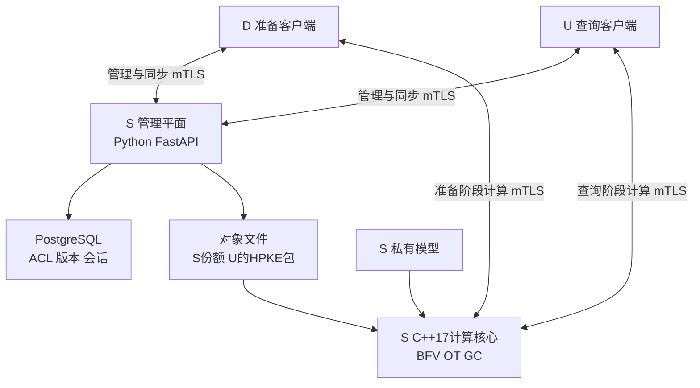
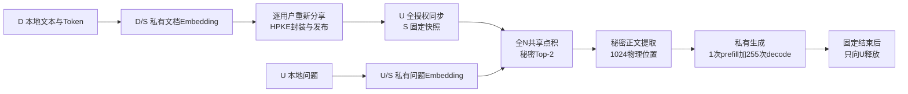

# 架构与技术约束

适用范围：第一版隐私RAG系统。本文件给出模块和强制规则；参数与接口.yaml给出具体形状、公式与执行次序，04_协议与数据流程.md给出密码交互与数据流。三者共同构成文件夹内的实现契约。

依据DEC-008，本文件保留技术语义，不制定测试流程和验收门槛。质量评估标准留待后续讨论。

## 总体架构

Python 管理平面取得角色允许看到的元数据及受保护文件；S 管理API不接收问题明文。客户端与服务端计算核心各自持有份额，模块内部完成协议后继续交付份额。

## 计算数据链

## 接口契约

所有接口描述包含会话、模块、形状、表示类型、模型及协议版本。模型算术张量额外声明59位环、有符号语义和小数位；布尔对象声明XOR分享及位宽，BFV与GC内部对象声明各自模数、位宽和布局。不能把GC大整数强行压成59位，也不能把布尔份额当算术份额相加。持久输入另匹配用户、资料版本、授权/份额代次；公开描述不携带秘密统计。

| 接口 | 输入 | 输出与责任 |
| --- | --- | --- |
| LinearPrivateWeight | 两方共享X，S私有W | 原始乘积份额，未隐含Rescale；f12×f12→f24，one-hot f0×表f12→f12 |
| MulShared | 两个共享张量 | 同环乘积份额，尺度相加，一次性材料消费 |
| A2B / B2A | 环份额 / 布尔份额 | 相同数值的另一表示；不是明文重构 |
| Compare / Equal | 共享整数与明确符号规则 | 秘密布尔位 |
| Select | 秘密位，两同语义候选 | 选中值份额；需乘法时包含或调用B2A |
| RescaleFloor | 共享整数，公开缩放位数 | 精确向负无穷截断后的份额与新f |
| LookupPublicTable | 共享索引，公开数学表 | 表值份额；不适用于S私有Token表 |
| RevealAnswer | 最终允许输出份额与最终状态 | 只向U恢复规定输出；无通用Reveal张量接口 |

序列化布局、调用ABI、字段字节级封装尚须形成实现格式工件，不得把本表当成已经存在的API代码。

## 安全与可见性

### SEC-001 参与方与在线关系

**MUST · 已定约束。** 业务角色固定为 D 资料提供方、U 提问方、S 模型与计算服务方。准备由 D/S 两方执行，日常查询由 U/S 两方执行；D 准备后可离线，新授权、更新、恢复所需重新分享由 D 返回完成。

### SEC-002 安全假设

**MUST · 已定约束。** 第一版采用半诚实、两计算方不串通假设；准备阶段 D/S 不串通，查询阶段 U/S 不串通。不得宣称恶意安全、串通安全或恶意 S 下独立来源证明。

### SEC-003 秘密对象

**MUST · 已定约束。** S 不获得问题、资料原文、完整向量或完整中间结果；U 不获得资料原文接口、完整检索向量或 S 模型参数；实际索引、分数、候选数、机构本次贡献不额外披露。最终答案仅向 U 恢复。

### SEC-004 允许公开信息

**MUST · 已定约束。** 真实授权块总数 N 对 U/S 可知；机构、内部资料编号、ACL 对 S 可知。U 仅额外得到自己的不透明槽位、版本和授权总数，不获得机构分布字段。不得把这些允许信息改写为额外隐私承诺。

### SEC-005 输出与语义边界

**MUST · 已定约束。** 正常结果仅为回答正文及规定运行/最终状态；无原文下载、原文引用、命中清单、相似度、来源或贡献计数接口。答案复述、语义推断、多轮累计披露单独评价，不以“没有原文接口”证明不存在泄漏。

### SEC-006 固定调度

**MUST · 已定约束。** 相同公开快照与配置下，计算数据帧数量/长度、全扫描访问、生成轮数不得因秘密有效长度、候选数、EOS、零权重、命中机构或秘密数值失败变化。不得宣称已完成所有底层恒定时间与硬件侧信道防护。 独立心跳按公开时钟发送，数量随实际会话耗时记录；不能用计算帧固定的检查替代对时间观察的分析。

### SEC-007 评估隔离

**MUST · 已定约束。** 仅在公开/合成或相关各数据及权重持有方授权的独立离线评估环境恢复测试中间结果。生产查询不得拥有通用秘密重构、管理员代解密、明文模型回退或中间向量导出路径。

## 密码与信道

### CRY-001 统一表示

**MUST · 已定约束。** 模型算术张量在模块间统一使用模 2^59 加法份额；储存余数范围 [0,2^59)，有符号解释范围 [-2^58,2^58)。布尔份额采用XOR表示，A2B/B2A显式转换；BFV和GC内部大整数使用自身模数与位宽。单方份额不是明文模型数值，不得按份额幅度执行模型范围判断。

### CRY-002 三条计算路径

**MUST · 已定约束。** 份额加减与公开重排本地执行；共享输入乘 S 私有权重由 BFV 线性适配器完成；共享×共享、非线性、比较、选择、表示转换采用两方协议。文档向量是共享输入，不得作为 S 明文权重处理。

### CRY-003 BFV 初始模板

**MUST · 已定约束。** SEAL 4.1.2、BFV、t=2^59、poly_modulus_degree=16384、7 个 60 位系数素数、tc128。读取实际 parms_id/Q/链级；初始数据层通常为 6 个 60 位素数，不能以 7×60 代替实际 Q。模板未经启用验证不得称合格参数。

### CRY-004 打包与分块

**MUST · 已定约束。** 采用有界矩阵系数打包，不使用BatchEncoder。B≤16、K≤8192、O≤155648，公开枚举d为16起的2次幂且d≤8192/B，s=2d−1，c=min(floor(512/B),floor(8192/(B*d)))，按输入及返回实际字节选择并绑定v3描述符。目标(oB+b)s+d−1互不污染，原B512界不变。QKV及gate/up各调用内复用输入；gamma采用59次OT/坐标的私有对角乘法。Token固定155648扫描及19输入，九级独立无环换钥合并512目标，每tile仅返回一个c1；其权重域、独立噪声界和专用GC必须成立。通用长输入保留19块入口。尺度、原floor节点及隐私边界不变。

### CRY-005 线性受保护返回

**MUST · 已定约束。** BFV返回减全多项式新鲜全环R并加独立Enc(0)，S只发c1并保留c0，C本地求u=c1*sk。普通矩阵在4*t*B512<q下每至多512目标共用122AND/目标的精确进位GC，C输出A+k-rho，S输出WX_S+R+B+rho。Token采用参数表独立E_token和358AND/目标GC，在秘密状态精确消除512因子并重新分享；不得把它泛化为任意矩阵除法。两者不公开联合相位、无掩码进位、对方高部/余数、非目标系数或完整结果密文。零权重走相同调度，失败烧毁会话。

### CRY-006 计算私钥

**MUST · 已定约束。** 准备会话 BFV 私钥仅归 D，查询会话仅归 U；非阈值密钥。按计算会话生成、结束销毁，不向 S 交付，不与长期身份/HPKE 密钥混用。

### CRY-007 OT 与 GC 状态

**MUST · 已定约束。** SCI 固定提交 f24bf3e022dde3493cf0ffe3ebd92dd73936b734；Naor–Pinkas/P-256 基础 OT、SplitIKNP 算术预处理。GC 使用该提交内 EMP-SH2PC 派生组件和独立 IKNP 状态；不另混装 EMP，不接入 SCI 历史 HE，不使用 OTPack::copy。

### CRY-008 共享乘法

**MUST · 已定约束。** 采用一次性乘法三元组(A,B,T)，其中T=A*B，处理交叉项并返回同环份额；公开差值DeltaX=X-A、DeltaY=Y-B后，C输出T_C+DeltaX*B_C+A_C*DeltaY，S输出T_S+DeltaX*B_S+A_S*DeltaY+DeltaX*DeltaY。矩阵预处理可按DEC-015用BFV计算两个随机交叉项，真实输入仍共享；逐元素保留OT。公开乘积恰好由S加入一次。矩阵因子顺序保持DeltaX*B_i、A_i*DeltaY；不得交换因子。不得交换原份额补交叉项，也不得将两个本地乘积相加冒充完整乘法。

### CRY-009 一次性材料

**MUST · 已定约束。** 三元组、OT 派生随机材料、结果掩码和重随机化随机量必须独立消费，使用前登记占用；崩溃后消费状态不确定即作废。长期有效资料份额可复用，但不因此复用一次性材料。

### CRY-010 精确截断

**MUST · 已定约束。** RescaleFloor 语义为有符号数学 floor。基线 A2B→符号扩展右移→B2A；允许固定形状GC内完成同一操作并新鲜重新分享；禁止各自右移份额。SCI truncate 仅等价验证后可用；div_pow2 向零舍入不得替代。

### CRY-011 秘密比较与选择

**MUST · 已定约束。** A2B/B2A 等值转换；Compare/Equal 返回秘密位；Select 在安全计算内选择。禁止恢复秘密条件、以单份是否为 1 执行 if，或用秘密下标直接访问普通数组。

### CRY-012 两类查表

**MUST · 已定约束。** 公开数学表为固定全表秘密相等选择；256项批量GC可用等价one-hot树与公开常量XOR，输出重新分享；私有 Token 表为秘密 one-hot 与 S 私有表权重的受保护线性计算。公开表值不使秘密索引公开；SplitKKOT 等替代须证明相同功能与边界。

### CRY-013 信道

**MUST · 已定约束。** 管理与计算采用职责分离的 mTLS 连接；TLS 1.3、内部 CA、Ed25519 身份签名、X25519 密钥交换。传输加密不代替秘密计算；除规定的最终授权释放外，不得将对方所缺的原始份额作为应用明文发给它。

### CRY-014 交付与静态保护

**MUST · 已定约束。** HPKE Base，X25519/HKDF-SHA256/AES-128-GCM，cryptography 49.0.0；包绑定接收用户、接收密钥版本、不透明槽位、资料版本、份额代次、格式版本。来源依赖 D 的 mTLS 身份与半诚实 S 登记；D 本地保留文件使用 AES-256-GCM 与系统密钥存储。

### CRY-015 启用证据

**MUST · 已定约束。** 启用前检查实际库参数、tc128、噪声/正确解码条件、整数范围、分享转换与 R1/R2 一致；整个会话解码失败概率目标上界 2^-64 未获证明前不得写为已经满足。噪声预算、解密相位和详细中间值不发给对方、不入普通日志。

## 数值语义

### NUM-001 量化与尺度

**MUST · 已定约束。** 实数 x→floor(x*2^f)；负值同为向负无穷取整。f 是公开模块规格；不同尺度加法须对齐，乘法尺度相加。Token、索引、有效位、计数保持 f0。BFV 最近整数解码与模型 floor 是不同功能。

### NUM-002 固定精度

**MUST · 已定约束。** 主干/权重/gamma/QKV f12；原始 f12 乘积与 logits f24；NR、指数、倒数、注意力概率 f24；RoPE/attention 常数 f20；检索向量 f20，1024 维点积 f40。按参数与接口.yaml的numeric_pipeline逐算子截断次序执行，不逐项截断代替累加后截断。

### NUM-003 运行域

**MUST · 已定约束。** 量化权重、gamma、Token表参数幅度≤256；普通主干激活幅度≤2048；逐头Q/K归一化、RoPE输出与K缓存采用参数与接口.yaml的numeric_pipeline.range_policy.qk_local_domains独立界。SwiGLU joint及down输入幅度≤4194304；down输出与残差采用numeric_pipeline.range_policy.coordinated_domains的维数相关C_d界；所有线性运算绑定实际权重哈希及每行L1。P∈[0,1]，检索向量分量幅度≤2，NR状态∈[0,2]。上界约束重构语义，不约束单方随机份额。

### NUM-004 先证明再检查

**MUST · 已定约束。** 每项乘法、累加、移位先有不回绕上界，工程中间预算严格小于2^56，有符号边界2^58。RMS/L2逐坐标先检查再平方、先检查剩余预算再累加；行内任一失败使整行向量秘密替换0、归一化分母替换f24的1及k=0，并累计秘密失败位、继续固定执行。不得先模回绕再检查，不得把静默裁剪结果当作正常答案。范围或绑定前提不成立时不得启用对应配置。

### NUM-005 秘密失败

**MUST · 已定约束。** 主干超界按规定安全替换为 0 并累计秘密失败位；特殊非线性使用其安全 dummy 输入。保持固定工作量；最终只向 U（准备阶段 D）报告规定失败，失败准备产物不发布，不释放替换后的正常答案。

### NUM-006 逆根与倒数

**MUST · 已定约束。** 逆根归一化尾数目标区间 [1,4)，初值 1/2，固定6轮 y←y(3−my²)/2；倒数尾数目标区间 [1,2)，初值 1/2，固定6轮 r←r(2−mr)。a=2^(2k)m 和 a=2^k m 是理想归一化关系；实际定点尾数按参数与接口.yaml的nonlinear_algorithms.secret_scaling所列floor移位步骤生成，不要求量化后仍满足实数精确等式。二数乘法按规定次序回到 f24；秘密 k 用固定形状移位处理。

### NUM-007 尺度与 epsilon

**MUST · 已定约束。** RMS尺度k∈[-10,8]，L2尺度k∈[-12,13]，倒数尺度k∈[0,10]；RMS epsilon=1e-6的f24整数为16，不得在f12把epsilon量化成零。归一化尺度由秘密区间比较选择，移位、固定迭代与逐项floor次序按参数与接口.yaml的nonlinear_algorithms执行；不允许以浮点函数或本地份额右移替换。

### NUM-008 指数与 SiLU

**MUST · 已定约束。** exp(-a) 的固定路线为三个8位/256项公开 LUT，a 为 f12，表值 f24，二数乘法后截断。a>32 的指数尾项置零；不是把 SiLU 的 x 裁成32。执行稳定 SiLU 的秘密正负选择与倒数路线。

### NUM-009 掩码 Softmax

**MUST · 已定约束。** 仅有效且因果可达项参与最大值及指数；无效 query 行先构造合法 dummy 分母再秘密置零。不得除零后乘0、将浮点负无穷塞入环、把 f24 概率提前改 f12。P_f24×V_f12 在 f36 累加后降 f12。

### NUM-010 L2 出口

**MUST · 已定约束。** 按秘密最后有效位置取 hidden，执行参数与接口.yaml的nonlinear_algorithms.L2固定流程；零或无效向量输出零向量和秘密有效位0，不能将有效状态公开。最终向量 1024 维 f20，分量幅度≤2；无效向量不以分数零假装最差候选。

## 模型与输入

### MOD-001 固定模型

**MUST · 已定约束。** Embedding 使用 Qwen3-Embedding-0.6B revision 97b0c614be4d77ee51c0cef4e5f07c00f9eb65b3；生成使用 Qwen3-1.7B revision 70d244cc86ccca08cf5af4e1e306ecf908b1ad5e；原模型语义参考 Transformers v4.51.3。开源权重仅是实验选材，协议仍保护 S 私有权重。

### MOD-002 真实架构

**MUST · 已定约束。** 两模型均28层、16个Q头/8个KV头、head_dim=128；Embedding hidden=1024/FFN=3072，生成 hidden=2048/FFN=6144。Q/K逐头RMSNorm、GQA、因果注意力、RoPE、SiLU门控FFN、两残差及末RMSNorm都保留。不得按 hidden/Q头数推导头宽或删除归一化。

### MOD-003 模型形状与绑定

**MUST · 已定约束。** 矩阵形状为输出维数×输入维数。Embedding的token表151669×1024，Q投影2048×1024，K/V各1024×1024，O投影1024×2048，gate/up各3072×1024，down为1024×3072；生成的token表及输出头151936×2048，Q/K/V/O投影分别为2048×2048、1024×2048、1024×2048、2048×2048，gate/up各6144×2048，down为2048×6144。词表权重绑定，无额外线性bias。Embedding不运行词表头，生成完整运行输出头；逐层归一化参数形状见参数与接口.yaml的models。

### MOD-004 固定容量

**MUST · 已定约束。** 问题正文≤128生成Token；完整问题Embedding固定160；块正文≤256、目标重叠64；文档Embedding固定257；Top-2；生成prefill固定1024，输出固定256；每层8KV头、1280物理缓存位置。所有模板/结束符均计入对应预算。

### MOD-005 输入格式

**MUST · 已定约束。** TXT/Markdown正文，UTF-8/LF/NFC、去BOM，非法解码明确拒绝。分块回退到合法字符边界再分词，不固定假定步长192，不混合不同授权资料。正文/问题保留控制串由输入持有方拒绝，不静默替换或截短。

### MOD-006 两种 Token 流

**MUST · 已定约束。** 问题Embedding完整格式化后独立分词并采用官方后处理；文档Embedding附加151643。生成使用正文片段与公开结构分别分词的规范拼接流；R0/R1/R2输入相同。不得混用两套完整序列。

### MOD-007 生成模板

**MUST · 已定约束。** 单轮证据问答；官方system/user/assistant模板，enable_thinking=false并保留其空思考前缀，user依次问题/证据一/证据二。system要求有据回答、不足/冲突说明、概括表达、拒绝整段导出。精确文本/控制串清单/槽位偏移由实施AI按上述行为要求、官方模板和固定预算自主确定，形成版本化模板工件与规范Token流，无需逐项确认。

### MOD-008 秘密位置

**MUST · 已定约束。** 有效位前缀和-1给逻辑位置，无效选0；RoPE查表索引秘密，K缓存已旋转不重复RoPE。物理地址由公开轮次决定，禁止按秘密长度压紧。首个logits秘密取最后有效hidden，不误取末物理项或有效数-1的物理地址。

### MOD-009 固定 greedy

**MUST · 已定约束。** 生成只允许ID 0..151642及EOS 151643/151645；并列取较小ID，无采样、额外惩罚。logits f24直接argmax，无须输出头Softmax，不影响注意力Softmax。

### MOD-010 固定输出循环

**MUST · 已定约束。** prefill产生首Token，固定255次decode回送，共256位置。EOS更新秘密alive与有效位，EOS不作正文，后续dummy仍同形状执行；最后缓存写1278，1279可空。到上限未EOS仅向U标记长度上限，不加轮次。

### MOD-011 产物版本

**MUST · 已定约束。** 权重、tokenizer、模板、数值配置、公开常量表分别登记hash；未取得实际文件不得填伪hash。变更需形成新配置并同步R0/R1/R2的语义、布局与数值范围定义；质量测试要求留待后续讨论。

## 数据与检索

### DAT-001 资料计算记录

**MUST · 已定约束。** 每块存生成正文t[256]、有效位m[256]、向量z[1024]和向量有效位e；t/m/e离散f0，z为f20。服务方准备份额、逐用户份额、HPKE包、管理元数据区分，不把服务侧份额统称BFV密文。

### DAT-002 逐用户独立分享

**MUST · 已定约束。** D已知t/m逐用户重新取随机份额；已有D/S共享z/e使用delta重新分享。delta逐用户/块/坐标/代次独立；换HPKE钥匙重包旧份额不算重新分享。

### DAT-003 存储与发布

**MUST · 已定约束。** Python/FastAPI管理，PostgreSQL管理账户/ACL/版本，较大份额与HPKE包用对象文件目录。新版本暂存→完整校验→原子发布；失败保留旧完整版本，无旧版则该范围不可查询。

### DAT-004 全量同步

**MUST · 已定约束。** U每次查询前完整同步当前全部授权包；不得按命中取包。U核对HPKE认证上下文和同步清单；双方材料需匹配用户、槽位、资料/份额/格式/模型数值版本。

### DAT-005 受理与快照

**MUST · 已定约束。** 身份认证、ACL、材料就绪分别检查；排队/忙碌不等于受理。正式受理再次检查并固定权限、资料、份额、模型数值配置；保留所引用版本到会话结束。

### DAT-006 撤权与恢复

**MUST · 已定约束。** 撤权前已受理查询可按旧快照结束，后续新会话不能使用失效范围。失败重试是新查询、重新核验。撤权不承诺删除U旧文件或收回已得答案；U换钥匙由D重新分享；D无备份不伪造恢复。

### RET-001 全扫描打分

**MUST · 已定约束。** 只对快照授权集合N全量执行f20×f20的1024维共享点积，f40整数直接比较；不对随机向量份额运行普通向量数据库检索。

### RET-002 精确 Top-2

**MUST · 已定约束。** 两轮固定安全比较树：有效优先、分数降序、用户槽位序号升序；第二轮秘密排除已选有效记录。树只带分数/索引/有效位，虚拟或无效候选不能凭占位分数胜出。

### RET-003 秘密提取

**MUST · 已定约束。** 秘密one-hot对全部N条的256个t/m位置选择求和；无效结果槽保持秘密无效且使用允许dummy。不得打开索引让数据库按命中取行。

### RET-004 I7 第一版范围

**MUST · 已定约束。** f20分量floor右移12位，T=sum(a*b)*4096²；B=1024*(2*2^21*4095+4095²)。用第2大有效下界tau，仅U_i<tau排除，等号保留，不足2条全保留。第一版仍全N高精度计算、保留位秘密，不压缩/跳算/公开候选数，不设加速承诺。

### RET-005 I8 第一版范围

**MUST · 已定约束。** 全授权同步、全扫描、秘密选择、固定证据槽与生成回送共同实现贡献保护；相同用户/快照/公开档位比较观察轨迹，不把不同公开N或答案语义差异计作必须隐藏的元数据。

## 运行与恢复

### RUN-001 单会话调度

**MUST · 已定约束。** S全局一次仅运行一个安全计算会话；其他请求排队或明确忙碌。活跃计算不设总耗时限制。

### RUN-002 消息契约

**MUST · 已定约束。** 每条计算消息绑定会话、阶段、操作顺序和公开配置；计算载荷为定长二进制，管理头JSON。完整宽度编码，不按秘密内容压缩。旧消息/重放/错序/形状或版本不一致不得猜测消费继续执行。

### RUN-003 心跳

**MUST · 已定约束。** 独立发送30秒固定心跳，连续6次未收到、180秒固定失活窗口终止；不等待计算阶段、不随秘密状态变化。公开断连/进程退出/消息损坏/版本不符可终止。

### RUN-004 重试

**MUST · 已定约束。** 无密码状态断点续算，无查询/释放自动重试；仅可安全幂等的包同步自动重试。新查询重新授权、分配新session/BFV/OT/一次性材料，消费不确定材料作废。

### RUN-005 结果释放

**MUST · 已定约束。** 固定生成结束且最终状态允许后，仅S→U交付指定答案Token/有效位/状态份额。秘密数值失败仅给规定失败，不先放正常答案。释放中断不标成功、不声称已发送内容收回或公平交换。

### RUN-006 特殊输入

**MUST · 已定约束。** 公开N=0直接固定无授权提示且不启动模型；只有一条有效证据补无效槽。秘密零查询向量/全无效资料继续固定计算，最终证据不足。过长/控制Token本地拒绝。

### RUN-007 持久状态

**MUST · 已定约束。** D加密保留文本、切块、ACL、准备份额、清单和必要密钥备份；S保留准备/逐用户份额与加密包；U保留接收钥匙与当前份额。身份/HPKE长期密钥和BFV临时钥匙分开。会话结束清理临时中间状态。

### RUN-008 日志

**MUST · 已定约束。** 普通日志只记录必要账户、公开版本、会话号、起止时间、通信成本和公开故障；禁止问题、答案、向量、份额、候选标记、命中、机构贡献及EOS位置。受控评估输出另隔离。
