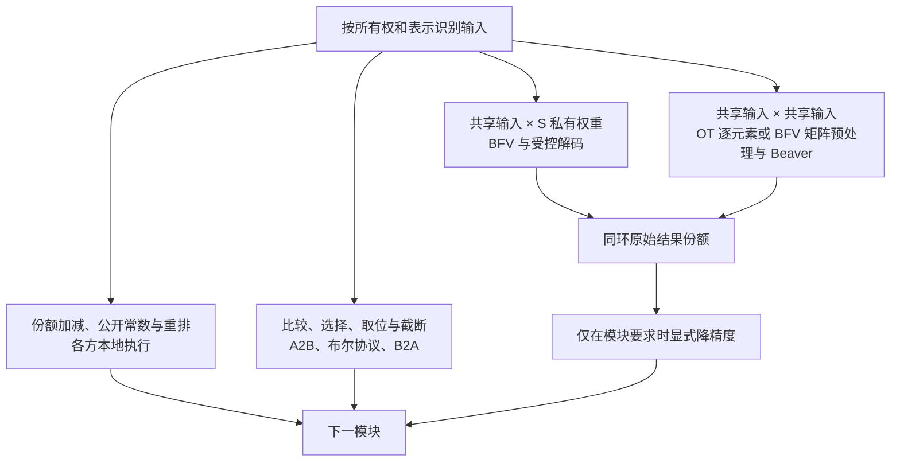
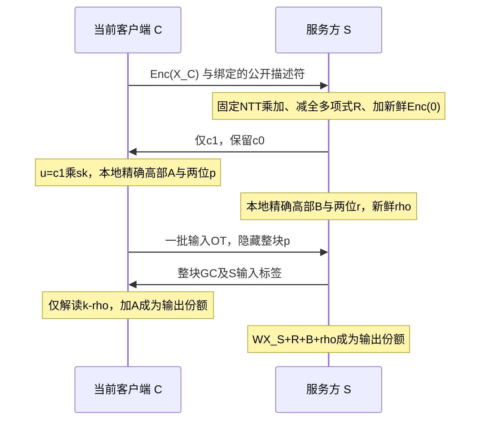
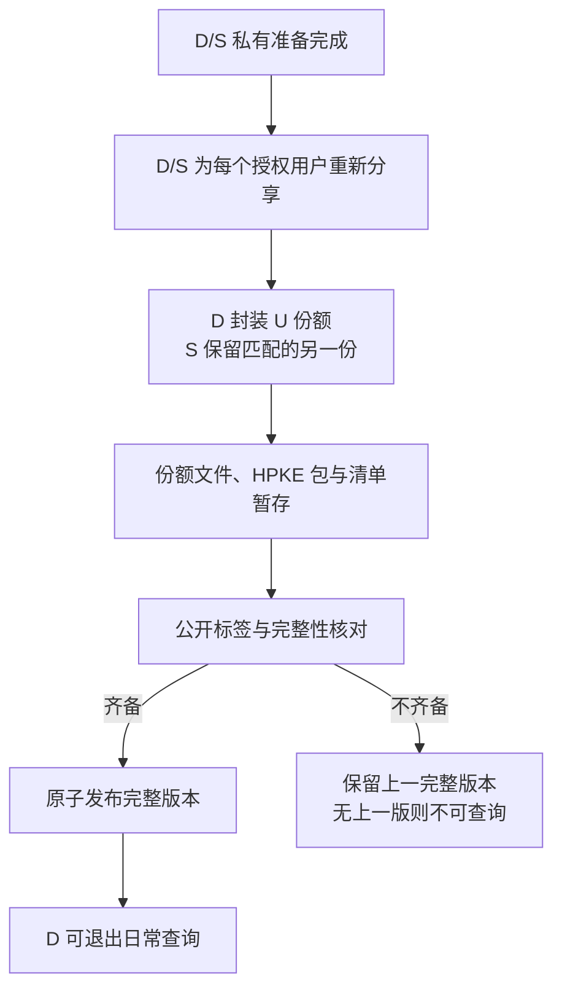
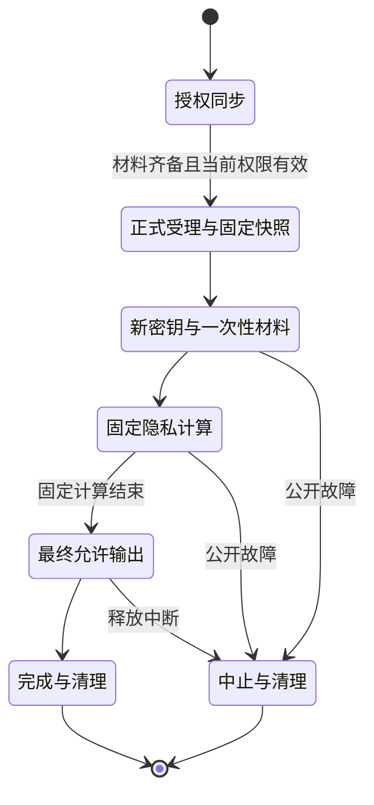

# 协议与数据流程

## 适用范围与表示

本文件定义第一版密码原语、资料交付和运行状态的实现契约。模型计算顺序与模块精度由同目录的架构文件和 `参数与接口.yaml` 给出；本文件展开这些模块调用的协议步骤。本文中的公式描述双方共同计算的功能，不授权任何一方恢复公式中的完整秘密变量。

| 符号 | 固定含义 |
|---|---|
| D | 资料提供方；完成准备与授权交付后不参与日常查询 |
| U | 提问方；运行客户端并参与每次查询的安全计算 |
| S | 同时持有模型权重并提供计算和受保护数据库的服务方 |
| C | 当前安全计算的客户端；准备阶段为 D，查询阶段为 U |
| M | 模型算术环模数，`2^59` |
| `[X]` | 加法份额 `(X_C,X_S)`，满足 `X=(X_C+X_S) mod M` |
| `⟦b⟧` | 布尔份额 `(b_C,b_S)`，满足 `b=b_C XOR b_S` |
| f | 公开的小数位数；整数 X 表示实数近似值 `signed(X)/2^f` |
| N | 当前用户获授权的公开资料块数；不表示 BFV 多项式参数 |
| n_poly | BFV 多项式次数参数，第一版模板为 `16384` |
| q | 当前 BFV 密文所在数据层的系数模数乘积；不同于模型模数 M |

加法份额以 `[0,M)` 中的余数保存；完整模型整数按 `[-2^58,2^58)` 解释有符号值。单方份额本身均匀分布在环上，不对其大小执行模型数值范围判断。所有环加减乘均在明确的模 M 语义下执行，不能依赖 C++ 有符号溢出。

本文件遵守 `CRY-001` 至 `CRY-015`、`DAT-001` 至 `DAT-006` 和 `RUN-001` 至 `RUN-008`。公开参数及类型定义入口为：

- `参数与接口.yaml → representation`
- `参数与接口.yaml → cryptographic_backends`
- `参数与接口.yaml → transport_storage_and_dependencies`
- `参数与接口.yaml → protected_documents`
- `参数与接口.yaml → interfaces`
- `参数与接口.yaml → runtime_and_lifecycle`

正常执行采用半诚实、双方不串通的安全假设。协议输出份额、一次性掩码和公开随机差值必须按各自类型处理；不得把“对方允许收到一个份额”扩大为“可以发送自己持有的所有份额”。

## 公共接口与本地操作

每个计算操作绑定公开的会话编号、操作编号、表示类型、形状、模型及数值配置版本、协议版本。算术张量另声明环位宽、有符号解释和 f；布尔对象声明位宽；BFV 和混淆电路对象声明当前模数、位宽及布局。

同一表示下的加减、公开置换和公开常数乘法，各方分别对自身份额执行。公开常数加法统一采用 C 加 `0`、S 加该常数的约定，避免两方重复加入。公开常数乘法则由两方均乘该常数。共享乘积的原始输出尺度为两个输入尺度之和，是否降精度由调用模块明确决定；密码适配器不得隐式截断。

## BFV 私有权重线性协议

### 输入与输出

接口为 `LinearPrivateWeight([X],W,descriptor)`。C 持有 `X_C`，S 持有 `X_S` 及完整私有权重 W。下列式子采用 `Y=WX` 方向；行向量实现可以采用对应转置布局，但不得改变逻辑维度或矩阵因子顺序。

输出满足：

\[
Y_C=A+k-\rho\pmod M,\qquad
Y_S=WX_S+R+B+\rho\pmod M.
\]

其中A=floor(t*u/q)、B=floor(t*c0/q)分别仅在C/S本地，k是下述精确进位，rho是S新鲜全环输出掩码；(A+B+k) mod t=(WX_C-R) mod t。其合成含义为 `WX`，小数位数为 `f_X+f_W`。C 只取得自己的结果份额，不取得完整返回密文、W、完整 Y、解密相位或非目标系数。S 不取得 C 的 BFV 私钥或输入份额。

### 密钥与上下文

每次准备或查询会话由 C 生成新的非阈值 BFV 密钥。私钥只保留在 C，会话结束销毁。S 获得协议所需的公钥和公开上下文，不托管 C 的私钥。

第一版使用 SEAL `4.1.2`，明文模数 `t=M=2^59`，`poly_modulus_degree=16384`，系数模数模板为七个 60 位素数，安全级别为 `tc128`。实际解码 q 必须从正在处理的密文 `parms_id` 对应数据层读取：它是该层实际素数的乘积。密钥层的七个素数、初始数据层通常使用的六个素数、以及某一时刻密文所在层不能混用。

普通矩阵与通用长输入仅使用密文与明文乘法及加法；Token专用路径增加下述独立无环跨钥自动同构，不生成同钥旋转或重线性化密钥，不使用 `BatchEncoder` 或密文与密文乘法。`SEAL_THROW_ON_TRANSPARENT_CIPHERTEXT` 固定关闭，使零权重产生的内部透明对象不触发秘密相关提前退出；该设置不授权发送透明对象。

实际素数、数据层q、上下文标识、精确本地大整数divmod、两位进位的整块GC布局及条件噪声正确性依据已登记于包内BFV工件与 `参数与接口.yaml → cryptographic_backends.BFV`。参数和局部探针形成不等于完整会话已运行；启用时仍须匹配实际上下文及全部条件。

### 通用长输入的系数打包

K≤8192的兼容向量接口统一转下述private_matrix(B=1)；本节长输入固定d=8192、每密文目标8191。

对公开块宽d及一组m个连续输出行，令步长s=2d-1。C和S分别按公开计划构造：

\[
X_C(z)=\sum_{j=0}^{d-1}(X_C)_jz^j,\qquad
W(z)=\sum_{r=0}^{m-1}\sum_{j=0}^{d-1}W_{r,j}z^{rs+d-1-j}.
\]

第r行的乘积支持区间为`[rs,(r+1)s-1]`，不同区间互不相交，目标`rs+d-1`恰为该行点积。取`1<=d<=8192`、`m<=min(16384//(2d-1),8192//d)`，保证最高次数`ms-1<16384`不发生负循环回绕，并使每个权重多项式至多有8192个非零系数、中心L1不超过`8192*2^58`。权重多项式留在S本地，不能因库称其为plaintext就向C公开。行分组、目标顺序及末组大小只由公开形状决定。

每次调用公开限制`1<=cols<=19*8192`。`cols>8192`时，所有块均固定d=8192、末块补零，目标恒为8191，不能把尾块改为另一个目标再直接相加。每块输入只加密一次，输入密文缓存保持不可变，供公开输出组复用。S按组逐块读取私有权重并将同层密文乘积相加；只对完成全部K块累加的密文作一次完整新掩码、一次新Enc(0)及整块受控返回。S的本地`W*X_S`同样先按环累加，再加对应目标掩码。原始块结果不得逐块提前降精度。

合并后的噪声条件使用`B_K=8194*(K*(8192*2^58)+1)`、`K<=19`及实际q核对`4*t*B_K<q`，不能沿用单块B而忽略K。精确同层密文加法不新增降模舍入；每个返回密文有独立全多项式掩码与Enc(0)，连续至多512个目标共用一次新GC对象、delta及标签；GC输入OT保持连续且不重复的独立流。非目标系数仍不输出。

**Token专用打包返回。** 真实词表的有效性先在秘密状态检查，失败编号选择安全0并累计失败位。底层一次a2b和固定18层前缀树构造155648项共享one-hot，所有19个8192项输入块均加密；S固定扫描全表，尾部补零。C不持有权重，输入份额、秘密编号和选中向量均不重构。

S在本地为每隐藏坐标累加19块密文乘积，加上自己的点积份额，再将8191目标移到常数项。对512个这样的本地密文作9层二叉合并：第l层a=16384/2^(l+1)、g=2^(l+1)+1，计算Switch_identity(A+z^a B)+Switch_g(A−z^a B)。目标网格上的偶位置保留2A，奇位置保留2z^aB，网格外系数不能进入网格。最后坐标i位于32·bitreverse9(i)，目标值为512m_i；这些逐坐标中间密文不发送。

C为每会话生成9把额外独立钥，换钥严格从s0→s1→…→s9，只提供每层identity和g的跨钥材料，无同钥或循环加密图，不增加循环/KDM假设。108个密钥层辅助密文及终端公钥实际传输200026336字节，在同一会话复用；初始公钥1835104字节、三条基础OT共173283字节另计。流式合并每tile有511次合并、1022次换钥，这些仍是实际计算成本。

终端密文减全多项式R并加终端钥的新Enc(0)，仅返回一份c1。1024/2048维分别实际返回2/4份c1。普通相位进位定理继续使用，但噪声必须改用Token独立界：E0=8194(19·2^71+1)+1，E_KS<2^24，E_token=4^9 E0+174762·2^24+8194，实际检查4tE_token<q。换钥界来自6n(2^60−1)21/p+(n+1)/2，其中p是实际第七素数。不得沿用普通B512替代该推导。

512在模2^59中没有逆元。这里只因one-hot选择的权重满足|m_i|≤2^20，所以|512m_i|≤2^29<2^58且低9位为零，能在GC内部精确有符号右移9位。Token GC接C的61位quarter+A和S的120位quarter+(B+R)+rho，计算恢复值再右移并减新rho；C得到m_i−rho，S得到rho。每坐标358AND，每512目标一个GC及一次31232选择的输入OT（扩展填充32768，标签按1024选择分帧）。这不是模型新增floor，不得泛化为普通矩阵除法。Token描述符为[PRAGTOK3,3,vocabulary,155648,H,512,8192,19,9,12]，与同一会话绑定。

### 模型投影的矩阵系数布局

矩阵入口接收本方B×K份额和S私有O×K权重，输出B×O份额，语义为Y=XWᵀ。B≤16、K≤8192、O≤155648。公开枚举d=16,32,…且d≤8192/B，令s=2d−1、c=min(floor(512/B),floor(8192/(Bd)))，按ceil(K/d)份输入与实际c1返回总字节最小选择d，并列取最小值。选择只依赖公开维度。

\[
X_h(z)=\sum_b\sum_{j=0}^{d-1}x_{b,dh+j}z^{sb+j},\qquad
W_h(z)=\sum_o\sum_{j=0}^{d-1}w_{o,dh+j}z^{soB+d-1-j}.
\]

每对(b,o)的卷积支持区间为[(oB+b)s,(oB+b+1)s−1]，目标(oB+b)s+d−1只包含相同输入列的乘积。不同区间互不重叠，最高次数Bc(2d−1)−1<16384，权重多项式至多cd≤8192个系数。末输入块固定d补零；每个输入密文仅在本次调用中复用。每个c1仍独立全多项式遮掩并加Enc(0)，公开外层g=floor(512/B)列以内可积累多个返回的本地方相位，再共用一次GC。因此返回数为floor(O/g)ceil(g/c)+ceil((O mod g)/c)，GC数为ceil(O/g)，两者不必相等。

普通矩阵仍至多512输入块，用B512=8194(512·2^71+1)及实际4tB512<q守卫；不引入换钥或额外降模。输出保持f_X+f_W，完整点积后执行原定floor，LM head保持f24。描述符为80字节大端[PRAGMAT1,3,B,K,O,f_X,f_W,d,c,512]。输入系数缓存绝对上界仍每方805306368字节，实际峰值还包括密钥、临时数组和GC。

Q/K/V在同一个调用中拼接为[2048,1024,1024]输出，gate/up拼接为[FFN,FFN]；额外80字节[PRAGJNT3,3,B,K,f_X,f_W,组数,O0,O1,O2或0]绑定每段。只在同一次调用共享输入密文，不跨非线性或会话缓存，分段后沿用各自floor12与范围检查。Prefill最多16行分批，Decode为1行。

RMS的gamma是S持有的逐坐标权重，采用私有对角OT。每坐标、每位j，S给出OT消息−r和2^j gamma−r；C以x_C的位选择并求和，S保留所有r之和并加gamma x_S。输出两份之和等于gamma(x_C+x_S) mod2^59。固定59次OT/坐标，新鲜全环r，返回f24后沿用floor12；没有稠密BFV对角矩阵，也不打开激活或gamma。40字节[PRAGDIA3,3,n,f_X,f_W]绑定形状与尺度。

这些描述符均由现有PRGCF001帧和TLS1.3 mTLS绑定。公开非法形状在网络前拒绝；协议开始后的描述符、回调或通信错误中止并烧毁材料；秘密失败仍维持固定调度。共享QK/PV继续使用共享乘法。局部mTLS执行、固定调度计数和完整模型运行是不同证据。

### 普通矩阵及通用长输入的受控返回

1. C 按公开块号依次加密打包的 `X_C`，向S发送K份输入密文；每块本次只加密一次。
2. S 对当前公开输出组依次乘入各块私有W，将全部K个同层密文乘积相加，同时本地按模环累加`WX_S`。没有未遮掩的块结果发送给C。
3. S 为整个返回多项式的全部系数独立采样新鲜全环掩码 R，在密文表示的明文结果中减去 R；不能只遮掩目标点积位置。
4. S 为该结果加入新的 `Enc(0)`。零权重结果执行完全相同的步骤。
5. 将重随机化后的双分量结果记为 `(c0,c1)`。S 仅发送 `c1`，保留 `c0`。
6. C 本地计算 `u=c1·sk mod (q,z^n_poly+1)`；不把 u 或 sk 明文交给 S。
7. S 和 C 分别把自己的 `c0`、u 转到正确的系数表示，并将每个所需系数从剩余数系统转换为 `[0,q)` 中的大整数。必要的逆 NTT 和剩余数转换在持有者本地完成，不能先合并两项。
8. 双方分别精确计算本地 divmod：C得高部A及余数a，S得高部B及余数b；这里a/b按q归一化后在[0,1)。仅取p=floor(4a)、r=floor(4b)，本地余数和高部不发给对方。
9. S给每目标独立采样rho∈Z_t；每公开tile（至多512目标）新建一个GC。C通过一批独立IKNP输入2T位p；S直接交付61T位r和rho的标签。电路计算k=floor((p+r+2)/4)及z=k-rho mod t，只向C解读z。
10. C本地输出A+z，S输出WX_S+R+B+rho，均模t。非目标系数、联合相位、无掩码进位均不输出。

### 有界相位的精确整块解码

数学目标仍是标准最近整数BFV解码；令v=(u+c0) mod q：

\[
m=\left\lfloor\frac{tv+\lfloor q/2\rfloor}{q}\right\rfloor\bmod t.
\]

双方本地用GMP精确divmod得到tu/q=A+a、tc0/q=B+b，A/B为整数，a/b∈[0,1)。圆周相位噪声严格小于B512=8194*(512*2^71+1)，实际锁定q满足4*t*B512<q。因此a+b与某整数k∈{0,1,2}距离小于1/4；若k=0则p+r=0，若k=1则p+r∈{2,3,4}，若k=2则p+r=6。于是

\[
k=\left\lfloor\frac{p+r+2}{4}\right\rfloor,\qquad m=(A+B+k)\bmod t.
\]

该等式覆盖全部允许环消息和噪声，包括模q回绕；它不声称适用于任意无效相位输入。生产入口仅在锁定参数/操作次数/噪声证明成立时使用，不能把它暴露为通用近似除法。u/c0可达360位、t乘积达419位，本地始终使用任意精度整数，禁止float或int64窄化。

两位进位电路每目标4个AND；59位rho减法118个AND。每tile一次GC，共122T个AND、2T个evaluator输入OT选择位、一次扩展批次；GC内没有大整数联合除法。rho全环均匀且独立，使C的z在其本地已有u/A/p条件下仍为均匀随机份额；GC隐私保护r/rho/p，S的份额只由其已持有量和新鲜rho形成。原全多项式R、fresh Enc(0)和c1-only同时保留，不能据此改发完整密文。

BFV精确解码不新增数值误差；后续模型RescaleFloor仍在完整点积后执行，f24乘积与f12激活的转换规则不变。

## OT 与共享乘法

### 状态初始化

基础 OT 固定为 Naor–Pinkas / P-256，算术扩展为 SplitIKNP，安全参数为 128 位。使用固定 SCI 提交 `f24bf3e022dde3493cf0ffe3ebd92dd73936b734` 中的必要底层组件；混淆电路使用同一提交包含的 `HalfGateGen`、`HalfGateEva` 及独立 IKNP 输入 OT。

C 发送/S 接收与 S 发送/C 接收两个方向分别初始化、分别消费随机状态。混淆电路输入 OT 不能共用算术 OT 的种子、随机流或计数器。禁止 `OTPack::copy`，禁止另行混装独立 EMP 发行版或接入 SCI 历史 HE 前端。

### 私有交叉乘积

功能 `CrossProduct(a,b)` 的发送方私有输入为 a，接收方私有输入为 b，均为模 M 的 59 位余数。此处发送/接收是单次协议角色，可以由 C 或 S 承担。

对 `j=0,…,58`，发送方独立采样 `r_j∈Z_M`，构造 OT 消息：

\[
(m_{j,0},m_{j,1})=(-r_j,2^j a-r_j)\pmod M.
\]

接收方以本地 b 的第 j 位 `b_j` 作选择。双方输出：

\[
p_{send}=\sum_j r_j\pmod M,\qquad
p_{recv}=\sum_j m_{j,b_j}\pmod M.
\]

满足 `p_send+p_recv=a·b mod M`，不打开完整乘积。负数同样按 59 位补码余数参与运算。59 个选择位可以按公开固定批量扩展，不等于必须逐位进行 59 次网络往返。

矩阵或逐元素乘法按明确的逻辑索引组合交叉乘积，不调用会隐式加位宽、末尾截断的 SCI 高层矩阵接口替代 59 位原始环乘法。

### 三元组生成

接口的公开描述指定乘法种类、输入形状、输出形状、环位宽及操作编号。C、S 各自独立采样匹配形状的 `A_C,A_S,B_C,B_S`。标量与逐元素三元组通过两个独立方向的 OT 交叉乘积协议得到下列两项；矩阵三元组采用后述 BFV 预处理：

\[
[P]=[A_CB_S],\qquad [Q]=[A_SB_C].
\]

各方形成：

\[
T_C=A_CB_C+P_C+Q_C,\qquad
T_S=A_SB_S+P_S+Q_S\pmod M.
\]

于是 `[T]=[AB]`。不存在另一个可信三元组发行者。矩阵三元组使用矩阵乘法及匹配维度；逐元素三元组使用逐元素乘法，不可混配。

矩阵输入为 `[X]` 的 `B×K` 与 `[Y]` 的 `K×O`，公开块限制为 `1<=B<=16`、`1<=K,O<=1280`。随机 A、B 采用对应输入形状，各方每次从完整59位环独立均匀采样。按 `DEC-015`，第一个交叉项调用 `private_matrix((A_C,0), S_private=B_S^T)` 得到 `[A_CB_S]`；第二个调用 `private_matrix((B_C^T,0), S_private=A_S)`，将共享输出公开转置得到 `[A_SB_C]`。第二项的 O 行按至多16行固定分块，两次调用始终由 C 持有 BFV 私钥。实际共享 X/Y 或 Q/K/V 不作为 S 私有权重交给 BFV。

随机系数的居中绝对值不超过 `2^58`，沿用普通 BFV 矩阵的通用 `4tB512<q` 条件、全多项式掩码、新鲜零加密、只返回 c1 和受保护精确解码；不能使用 Token 小权重专用界。预处理的随机环乘积不作定点截断。在线整块只打开一次 DeltaX/DeltaY，返回原始 `f_X+f_Y` 乘积份额，仍由调用模块在原有完整累加节点执行 floor。

批量矩阵公开描述符为 `PRAGBAT1`、版本1、操作码102，绑定 B/O/K、两输入小数位和有符号结果绝对界；描述符字段使用大端64位，当前锁定 x86-64 的环载荷使用小端64位且必须是规范59位余数。形状与参数核对后先登记一次性材料，再采样和消费。成功或异常退出清理本次持有的随机数组及临时副本；任一步骤失败中止会话并烧毁预留，不重用三元组。两个随机交叉项正确性与隐私的局部论证依赖既有 BFV/GC 原语及半诚实安全假设，不表示完整系统已经通过安全审计。

### 在线乘法

`MulShared([X],[Y],triple)` 先独占并消费一组三元组。双方交换各自的掩码差值份额，并只打开：

\[
\Delta_X=X-A\pmod M,\qquad \Delta_Y=Y-B\pmod M.
\]

随后本地计算：

\[
Z_C=T_C+\Delta_XB_C+A_C\Delta_Y\pmod M,
\]

\[
Z_S=T_S+\Delta_XB_S+A_S\Delta_Y+\Delta_X\Delta_Y\pmod M.
\]

公开交叉项仅由 S 加一次。矩阵因子顺序固定为 `ΔX·B_i` 与 `A_i·ΔY`；不能把矩阵乘法当作可交换乘法。输出表示 `XY mod M`，小数位为 `f_X+f_Y`，不隐式降精度。

原输入 X、Y、三元组 A、B、T 和完整 Z 均不得由该接口打开。某方作为原始输入所有者已经知道自己的输入，不改变协议对新增输出的限制。

## 布尔转换、比较与查表

### 布尔 AND

两个私有位 a、b 的交叉 AND 可使用位 OT：发送方随机取位 r，提供 `(r,r XOR a)`，接收方以 b 选择。双方输出的 XOR 为 `a AND b`。

对已 XOR 分享的 a、b，完整 AND 分解为：

\[
a\land b=(a_C\land b_C)\oplus(a_C\land b_S)
\oplus(a_S\land b_C)\oplus(a_S\land b_S).
\]

本地项各自计算，两个交叉项使用独立方向位 OT，并各自 XOR 所持结果份额。秘密 XOR 可本地执行；逻辑 NOT 等价于在秘密位上 XOR 公开的 1，只在一方份额注入该公开位。

### A2B

输入为 `[X]`，输出为完整 `X mod M` 的 59 个 XOR 分享位。各方本地拆分自己的余数，C 的第 j 位记作 a_j，S 的第 j 位记作 b_j；这些私有位作为安全布尔计算输入。

从秘密表示的公开 `c_0=0` 开始，固定执行 59 轮：

\[
p_j=a_j\oplus b_j,\qquad x_j=p_j\oplus c_j,
\]

\[
c_{j+1}=(a_j\land b_j)\oplus(p_j\land c_j).
\]

输出秘密位 `x_0,…,x_58`，丢弃最终 `c_59`，实现模 M。进位与输出位都不打开。直接 XOR 两个份额的位串不能替代该加法器。

### B2A

输入位 `b=b_C XOR b_S`。先用交叉乘积得到 `p_C+p_S=b_C·b_S mod M`，再输出：

\[
u_C=b_C-2p_C\pmod M,\qquad u_S=b_S-2p_S\pmod M.
\]

两份模环和为同一个 0/1。每一份本身不要求是 0/1。字级转换逐位执行，再由各方本地加权：

\[
X_i'=\sum_{j=0}^{58}2^j u_{i,j}\pmod M,\qquad i\in\{C,S\}.
\]

输出份额可以与转换前的随机拆分不同，但所表示的值必须相同。

批量路径可在固定形状 GC 内完成相同的 A2B、比较、选择、符号移位及 B2A：C/S 分别提交自己的输入，S 为每个算术输出新取完整环掩码 rho，GC 只向 C 交付 `X-rho mod M`，S 保留 rho；布尔输出对应采用新 XOR 掩码。双方主机均不重构 X 或秘密选择位。每批最多32768个逻辑坐标，绑定公开操作、维度和参数；每个 GC 使用新 delta、标签及连续消费的独立输入 OT 流。合并电路不移动模型的 floor 节点，也不改变秘密失败位与固定调度。

### 比较、相等与选择

比较的两输入必须具有相同尺度与明确的有符号解释。有符号比较先秘密翻转两操作数的第 58 位，再做固定宽度无符号比较。不得把可能发生回绕的 `X-Y` 的符号位直接当作完整有符号比较结果。

从最高位向最低位扫描，初始化秘密状态 `e=1,g=0`，每位更新：

\[
d_j=e\land x_j'\land\neg y_j',\quad
g_{next}=g\oplus d_j,\quad
e_{next}=e\land\neg(x_j'\oplus y_j').
\]

扫描结束，g 表示大于，e 表示相等；二者均保持秘密。其他关系由这些位按布尔逻辑组合，不按秘密结果提前停止。

`Select(⟦b⟧,[X],[Y])` 要求两候选形状、尺度和语义一致。先将 b 转为算术表示，再计算：

\[
[Z]=[Y]+\operatorname{MulShared}(\operatorname{B2A}(\llbracket b\rrbracket),[X]-[Y]).
\]

输出尺度与 X、Y 相同，因为选择位是 f0。禁止恢复 b 后普通分支、用某一份是否为 1 判断分支、或使用秘密索引直接访问普通数组。

### 确定性截断

`RescaleFloor([X],s)` 的 s 是公开非负整数，功能为：

\[
Y=\left\lfloor \frac{signed(X)}{2^s}\right\rfloor.
\]

执行 A2B，将每个输出第 j 位连接到原第 `j+s` 位；超过 58 的位置连接到原符号位。之后 B2A 返回新的模 M 份额。该路径保留负数向负无穷取整的语义。双方各自右移算术份额、向零舍入或引入随机末位误差均不符合接口。

### 两类查表

公开数学表 `T[0…K-1]` 的 K 和全部表值公开，秘密索引保持分享。固定扫描所有项，计算 `h_j=Equal(index,j)`，转换为算术位，再计算 `sum_j h_j·T_j`；乘公开表值由双方本地执行。索引合法范围由调用模块保证或按该模块的秘密失败与占位规则处理，不能为了查表恢复索引。

256项公开表允许等价的固定8层 one-hot 前缀树，公开常量位与相等位相与后逐输出位 XOR；合法索引恰有一个命中，因此与上式相等。环索引的高51位非零时命中全部清零，调用模块继续遵循原有秘密范围检查。完整公开表摘要在调用前绑定，GC 输出重新分享；不能采用秘密索引的主机数组访问或根据索引跳过分支。

私有 Token 表由 S 持有，公开的只是词表大小和形状。安全计算为秘密 Token 构造完整词表长度的秘密 one-hot，再通过 `LinearPrivateWeight` 乘入 S 的私有 Token 表。one-hot 为 f0、表为 f12，因此原始输出已为 f12，不再无条件截断 12 位。该流程不得替换成 U 接收完整表或 S 读取明文 Token 后本地查表。

## 资料准备与逐用户交付

### 计算记录与持有关系

每个资料块的计算记录为：

| 对象 | 形状与表示 | 初始持有关系 | 查询使用方式 |
|---|---|---|---|
| t | 256 个生成正文 Token，f0 | D 知道完整值 | U/S 加法份额 |
| m | 256 个正文有效位，f0 | D 知道完整值 | U/S 加法份额；需要位运算时显式转换 |
| z | 1024 维归一化检索向量，f20 | 私有 Embedding 后由 D/S 分享 | U/S 加法份额 |
| e | 向量有效位，f0 | 私有 Embedding 后由 D/S 分享 | U/S 分享 |

文档私有 Embedding 的输入是独立的 257 槽 Token 与有效位布局，不能直接拿它替代上述 t/m。两种 Token 流分别遵循 `参数与接口.yaml → input_templates_and_capacity`。

D 在本地导入文本、规范处理、切块和分词；D 与 S 完成私有文档 Embedding 后，各自仅保留 z/e 的准备份额。若出现秘密数值失败，保持该准备会话固定路径，最终仅 D 得到规定失败状态；失败产物不进入用户重新分享和发布。

### 重新分享

对 D 已知的 t/m，每个用户、资料块、坐标和新份额代次独立取 `r∈Z_M`：

\[
x_U=r,\qquad x_S=x-r\pmod M.
\]

对已有准备份额 `x=a_D+b_S mod M` 的 z/e，D 对每个用户、资料块、坐标和代次独立取 `δ∈Z_M`：

\[
x_U=a_D+\delta\pmod M,\qquad x_S=b_S-\delta\pmod M.
\]

D 生成用户侧份额，将 δ 经计算/管理协议约定的受认证路径交给 S，S 更新服务侧份额。S 可以知道 δ，但不得获得 `a_D+δ` 的明文；它经 HPKE 封装后才交给 S 托管。不得为整个向量重复使用单一 δ，不得把一个用户的份额直接复制给另一个用户。

重新分享保持原值且不恢复完整 z/e。对旧份额换一个 HPKE 接收密钥重新封包，不等于重新分享。

### HPKE 封装与绑定

D 使用 U 已登记且经过身份关联的接收公钥，采用 HPKE Base / X25519 / HKDF-SHA256 / AES-128-GCM 封装用户侧 t/m/z/e 份额。S 托管并转交包，U 本地打开后得到自己的随机份额，不得到原文或完整向量。

包必须认证绑定以下字段：接收用户、接收密钥版本、用户专属不透明槽位、资料版本、份额代次、格式版本；并与适用的公开配置及同步清单匹配。字段可以进入认证上下文或受保护正文后核对，不能只出现在可修改的文件名。

S 管理侧可以维护机构、标题、全局资料标识及 ACL；交付给 U 的字段不含机构名称、标题或全局资料编号。U 仅得到属于自己的不透明槽位和允许的版本信息。

Base 模式不独立认证 D 的发送者身份。本版来源登记依赖 D 上传时的 mTLS 身份与半诚实 S 的记录，不额外提供 D 对 U 的独立签名。文件摘要不能代替来源认证。HPKE的确切 `info`、AAD、正文和字段字节布局已登记于包内接口工件；实现必须使用绑定的格式版本和确定性编码，不得临时拼接。

### 暂存与原子发布

发布单元至少包含配对的 S 侧份额文件、U 的 HPKE 包和公开清单。状态顺序为：准备 → 暂存 → 完整性核对 → 原子发布。

核对用户、槽位、资料版本、份额代次、格式、模型数值配置和全部文件齐备性，不解密 U 的 HPKE 包或恢复秘密数据。发布通过一次原子引用切换使新查询只能看到旧完整版本或新完整版本，不能拼接不同版本的 t/m/z/e，不能配对不同代次的用户/服务份额。

失败发布保留上一完整版本；没有上一版时，对应范围不可查询。暂存文件不自动成为可计算输入。摘要算法、清单序列化及文件布局以包内接口工件为准；已发布状态不得仅由“最后一个上传请求成功”替代。

## 日常查询与版本生命周期

### 全量授权同步与正式受理

1. U 与 S 完成身份认证。S 根据当前 ACL 形成公开有序的授权槽位集合。
2. U 每次查询前完整同步全部当前授权包。同步不能依赖本次检索命中、秘密候选位或机构贡献数。
3. U 打开 HPKE 并核对认证绑定、清单标签及文件配对，形成完整本地份额集合。
4. 材料就绪后，S 正式受理时重新检查当前 ACL、已发布 S 侧材料、U 材料就绪状态以及公开配置兼容性。排队或显示忙碌不视为已受理。
5. 受理生成新会话编号和不可变快照，绑定用户、授权槽位、资料版本、份额代次、权限版本、模型数值版本、协议/格式版本及固定形状。
6. 快照所引用的 U/S 材料持续固定到完成或公开中止。运行时不能反复读取“当前最新版”动态指针替换输入。

N 是当前快照的公开授权块数。N 为 0 时可以在模型执行前返回“当前没有可用于回答的授权资料”。N 大于 0 时，双方按同一个公开顺序扫描全部 N 条记录，不按秘密结果临时下载、加载或跳过记录。

查询后续逻辑固定为：新的协议材料 → 问题私有 Embedding → 全扫描评分 → 秘密 Top-2 → 秘密证据提取 → 固定私有生成 → 最终允许输出释放。资料进入生成上下文由当前授权集合及秘密提取共同决定，U 不能自报旧槽位绕过 S 的 ACL 检查。

### 更新与撤权

资料更新先形成新版本全部配对材料，原子发布后供新查询使用。已受理会话继续使用原快照，S 保留其依赖的旧数据直到会话结束或中止。

撤权的生效点是正式受理边界：生效前已受理会话按原快照完成，之后的新会话排除撤销范围。旧会话失败后的重试是新会话，重新核对当前授权。撤权不收回已释放答案，也不保证 U 物理删除旧文件；后续限制依赖 S 拒绝为失效范围提供新的协议配合。

新增授权或重新授权需要 D 临时上线，使用 D/S 的准备份额重新分享并发布。D 离线且必要准备状态不可用时等待恢复；不得让 S 自行恢复完整资料或伪造用户份额完成交付。

### 持久状态与恢复

| 角色 | 保留状态 | 恢复边界 |
|---|---|---|
| D | AES-256-GCM 加密的源文本、切块、ACL、D 侧 z/e 准备份额、版本与发布清单；必要密钥备份分开离线保存 | 人工触发备份恢复；准备份额不足时重新私有 Embedding，不在 D 恢复完整向量绕过协议 |
| S | S 侧准备份额、逐用户配对份额、U 的 HPKE 包、ACL/版本/发布记录 | 不保管可替 U 解包的私钥，不把份额文件称为完整 BFV 密文 |
| U | 身份及 HPKE 密钥、有效授权的 t/m/z/e 用户份额、槽位及版本记录 | 仅复用仍在当前授权和版本范围内的输入材料 |

U 丢失 HPKE 私钥时，先核验身份、登记新接收密钥版本并停用旧版，再由 D 对仍有效授权生成新一代独立份额并发布；不能声称管理员可以解开旧包。BFV 私钥丢失只使当前会话终止，使用新会话、新密钥和新一次性材料重新开始。D 状态不足且无可用备份时，不声称可以从现有密文恢复完整源资料。

## 信道、调度与清理

### 消息与密钥分离

管理与计算使用独立的 TLS 1.3 mTLS 连接，项目内部 CA 关联身份，身份签名采用 Ed25519，密钥交换采用 X25519。长期身份密钥、HPKE 交付密钥、会话 BFV 计算密钥分别管理，不互相代替。

管理头使用 JSON，计算载荷使用固定长度二进制帧。每帧绑定会话、阶段、操作顺序和公开配置，并满足该公开操作与轮次确定的形状。完整宽度整数不得按秘密前导零压缩；重复、旧会话或乱序载荷按公开错误处理，不能猜测归属后继续消费随机材料。重复控制请求返回已有状态或明确错误，不重启同一密码计算。

TLS 终止后，对端仍能读取应用载荷，因此禁止通过已认证信道直接交付会重构受保护中间值的另一份。允许传输的是对应协议规定的密文、OT/GC 消息、被随机材料遮掩的差值及最终指定输出份额。

### 一次性材料

三元组、OT 派生随机区间、BFV 结果掩码、`Enc(0)` 随机量及会话随机量绑定会话/操作/形状/环参数，第一次使用前先登记占用。完成后不能再次消费；崩溃导致消费状态不确定时作废，不能以“未记录成功”为由复用。

材料可按公开固定块逐步生成，块大小与块数不得由秘密有效位或候选数决定。长期有效文档份额是可复用输入，与一次性运算材料分开管理。更换 TLS 连接或会话编号不会使旧随机材料重新安全。

### 公开故障与秘密失败

S 全局同时运行一个安全计算会话，其余排队或返回忙碌。活跃计算不设总时限。两端每 30 秒独立发送心跳，连续 6 次未收到有效心跳，按 180 秒失活窗口终止；心跳不等待模型阶段结束，也不取决于秘密 EOS 或候选数。

断连、进程退出、消息损坏、公开版本/形状/次序不匹配、心跳失活属于公开故障，可立即终止并清理。秘密数值失败则由秘密位累计：

\[
\llbracket f_{new}\rrbracket=\llbracket f\rrbracket\lor\llbracket e_j\rrbracket.
\]

它不得触发普通可见异常或提前结束。相应算子使用其合法占位输入继续同一公开调度，最终只向规定客户端释放失败状态。资料准备接收者为 D，查询接收者为 U；错误位置不作为日志或输出。

秘密失败不对应图中的公开中止边；其状态留在固定计算内部，至最终释放时选择允许的输出。

### 最终释放与重试

固定生成执行一次 Prefill 和 255 次后续 Decode，产生最多 256 个答案位置。EOS 仅更新秘密状态，不触发公开提前退出。最终安全计算根据有效位与秘密失败状态选择允许输出；不能先释放正常答案，再补发失败说明。

S 最终仅向 U 交付指定答案 Token、有效位和状态的对应份额。U 与自身份额合并，按 EOS、有效位和最终状态显示内容。S 不取得完整答案。不给 U 其他资料份额的另一半、原文片段、命中索引、评分、机构贡献数、模型权重或中间激活。

释放中断不记作正常完成；已经发送的内容不能撤回，本版不提供公平交换。查询和答案释放不自动重试；只有可安全幂等的资料包同步允许自动重试。再次查询重新核对授权、同步当前材料、创建新会话、生成新 BFV 密钥与独立 OT 状态并分配新一次性材料，不恢复旧密码断点，不降级为明文计算。

结束或中止清理 BFV 临时私钥、OT 会话状态、一次性材料、临时中间份额及 KV 份额，并释放快照引用；有效长期资料份额、身份/HPKE 密钥及公共版本记录按其用途保留。日志仅记录必要账户关联、公共版本、会话编号、开始/结束时间、总通信量及允许的公开故障，不记录秘密载荷、EOS 位置、候选位或秘密错误位置。

### 已形成的公开取消接口

当前实现由客户端在受理请求前生成随机会话UUID，S在原子受理时验证新鲜性并固定快照。本人可通过mTLS的 `POST /v1/sessions/{session_id}/cancel` 请求公开取消；接口不接受秘密数值失败字段或秘密原因。为处理取消先于排队受理到达的顺序，S保存账户绑定的取消意图并拒绝其后的同UUID受理，不重放原请求。

未由计算协调器claim的会话可直接中止并烧毁预留材料。已claim的会话只先标记取消，继续占有全局活跃名额；协调器终止并回收本任务子进程、关闭三条连接后，才提交中止、烧毁材料并释放快照引用。取消与完成通过同一事务边界定序，不能在旧worker仍运行时受理下一安全计算。正常SIGTERM/Ctrl-C走这条清理路径；SIGKILL、断电或数据库不可达时，必须由操作员确认旧worker和连接已停止后才恢复指定旧会话，数据库owner lock消失本身不是资源已经停止的证据。

D的成功与秘密数值失败均执行相同的公开完成状态等待，之后才在D本地决定是否形成可交付份额；U也只在公开计算阶段结束后本地解释最终状态。秘密结果不触发该公开取消接口。此处是既有故障和隐私规则的接口细化，不设置计算总时限或自动查询重试。

## 实施工件与实际证据

本文件给出逻辑输入、计算、输出和状态边界。实际工件及SHA-256统一登记于[决策与工件](决策与工件.yaml)，对应包内副本可直接读取：

| 工件 | 当前形成范围与边界 |
|---|---|
| BFV参数与受控返回 | 实际素数、数据层q、parms_id、上下文、本地精确divmod、整块进位GC及条件噪声界已形成；局部核对不代表完整会话成功 |
| 接口与账本 | 字节序、固定帧、操作编号、错误码、HPKE info/AAD/载荷、worker ABI、公开取消及材料账本已形成；完整模型与管理联合运行尚未完成 |
| 模型与数值 | 锁定模型、量化权重、常量及成套2048范围条件界已形成；完整R2未运行，R1实际完成范围按同版本工件记录 |
| 构建配置 | 依赖锁及固定SCI/SEAL组合构建已形成；后端能力以真实构建与运行记录为准 |

工件形成不构成新增正式测试或验收标准。合理数值调整按DEC-013由AI依据证据实施并直接同步现行规范、R1/R2和工件；若必须改变角色、安全假设、泄漏范围、模型修订、整数环、锁定密码规格或固定预算，则按行为准则商讨。缺失的必要前提只限制对应路径，不以占位值启用。
